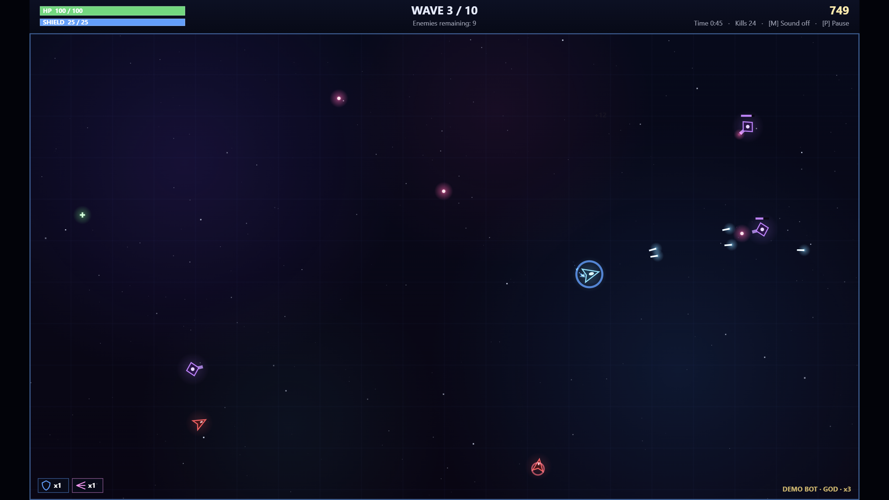
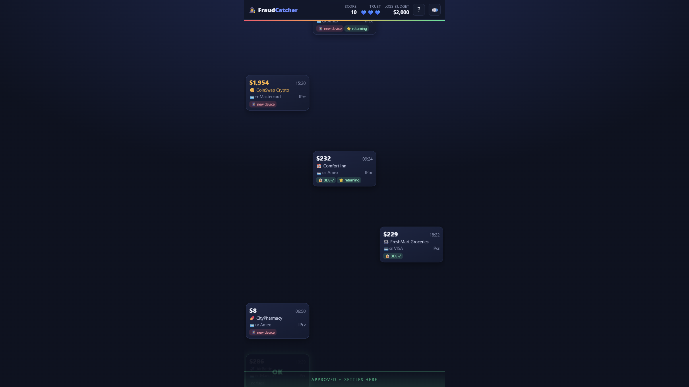
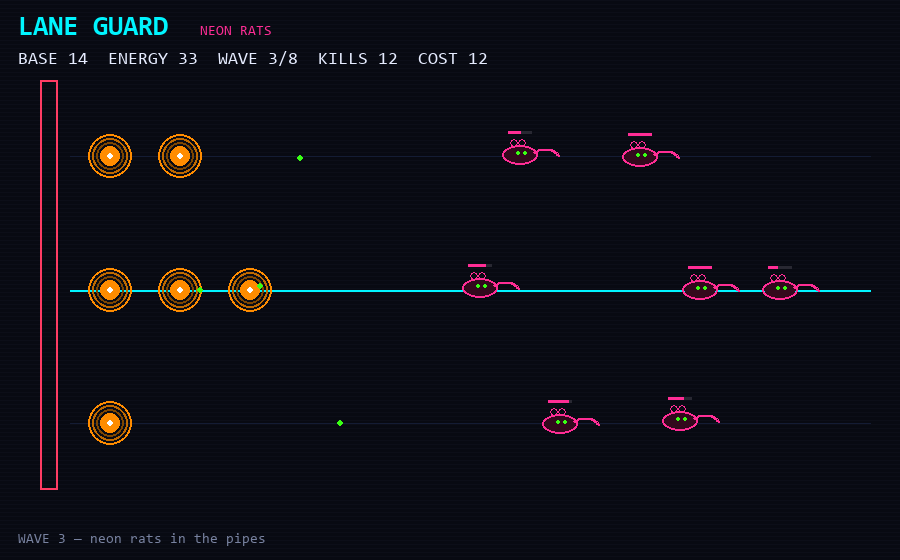

# Game Station

Small **playable prototypes** for game-design practice / portfolio.  
HTML + JS in the browser, plus a **Python / pygame** neon lane defender.

> Status: **prototypes / alpha** — balance and UX can change. Made to show mechanics thinking, not polished production art.

## Games

| Game | Folder | Pitch |
|------|--------|--------|
| **Space Arena** | [`space-arena/`](space-arena/) | Twin-stick / arena survival: waves, bosses, between-wave upgrades. Tuning lives in a top-level `CONFIG` block. |
| **Fraud Catcher** | [`fraud-catcher/`](fraud-catcher/) | Real-time judgment game: approve / block payment cards under time & budget pressure. |
| **Lane Guard — Neon Rats** | [`lane-guard/`](lane-guard/) | Python/pygame: 3 neon lanes, glowing rats, turrets + between-wave upgrades. |

### How to play

**HTML games**

1. Clone the repo (or download a folder).
2. Open `space-arena/index.html` or `fraud-catcher/index.html` in a modern browser.  
   Or: `npx --yes serve .` then open the printed URL.

**Lane Guard (Python)**

```powershell
cd lane-guard
pip install -r requirements.txt
python main.py
```

Details: [`lane-guard/README.md`](lane-guard/README.md).

---

## Space Arena



**Player loop:** survive wave → pick 1 of 3 upgrades → harder wave → beat final boss (optional endless).

**Why it exists (design practice):**
- Explicit **progression curve** (`hpScalePerWave`, spawn rates, boss cadence).
- **Risk/reward** via upgrade cards between waves (trade-offs, not only raw power).
- All balance knobs in one `CONFIG` so you can playtest and change numbers without hunting the codebase.

**What I’d iterate next:** clearer first-run tutorial, clearer “almost dead” feedback, one soft-fail mechanic before hard game-over, telemetry of which upgrades win most runs.

---

## Fraud Catcher



**Player loop:** cards fall → spot fraud signals (amount, merchant, geo, time) → approve or reject before they hit the gate → manage false positives vs misses under a budget bar.

**Why it exists (design practice):**
- **Information density vs speed** — same tension as real fraud ops / puzzle UX.
- **Asymmetric errors** (blocking good vs missing fraud) teach trade-off design.
- Readable chips / risk tags = readable “rules the player can learn”.

**What I’d iterate next:** short onboarding hand of labeled examples, difficulty tiers, end-of-run debrief (“you blocked X legit / missed Y fraud”).

---

## Lane Guard — Neon Rats



**Player loop:** place neon turrets on 3 lanes → rats crawl toward the base → clear wave → pick upgrade → harder stats.

**Fantasy:** cyan HUD + magenta **neon rats** (readable without art pipeline).

**Design practice:** economy (energy vs turret cost), lane attention, explicit `CONFIG` scaling (`hp_scale`, `spawn_gap`, upgrade mults).

**Next:** rats attack turrets, elite rat, sell/move, 30-second tutorial.

---

## Why this repo (for hiring / study)

Useful for a **junior game designer** path: show playable systems, written reasoning about loops and balance, and willingness to ship small prototypes fast (including with AI-assisted coding) — then critique them.

Not a Unity/Unreal showcase; engine experience can come next. These files are about **mechanics + playtest thinking**.

## License

Personal portfolio prototypes. Ask before reusing commercially.
